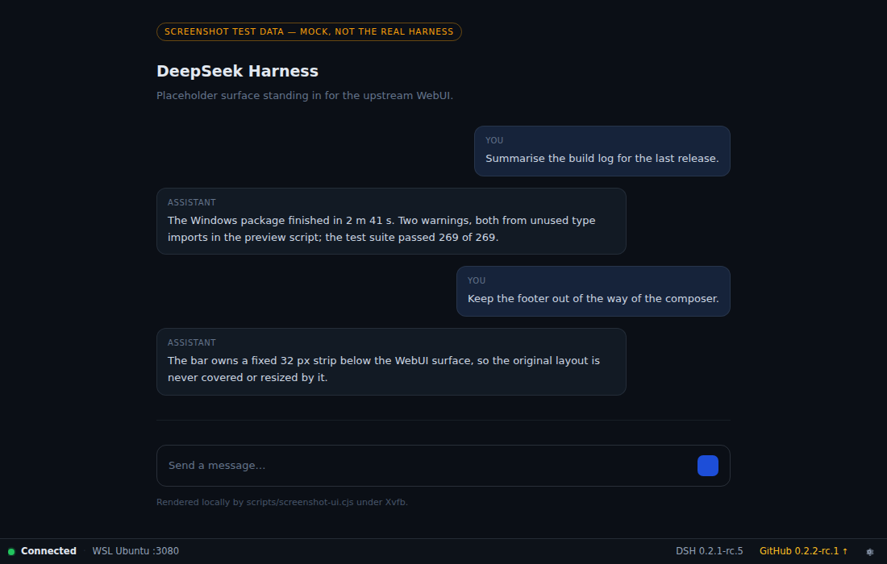
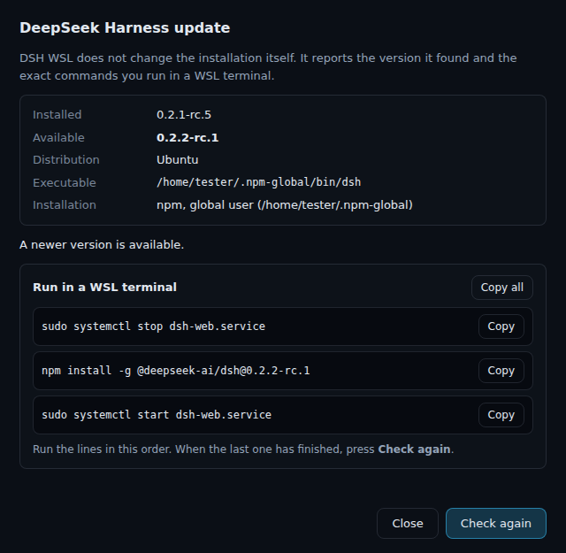
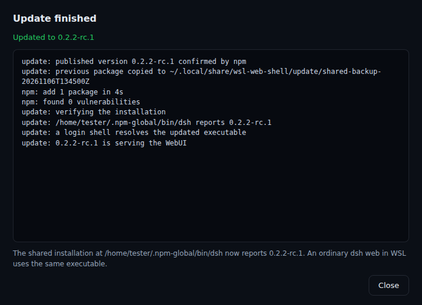

# WSL Web Shell

**Open-source Windows desktop wrapper for local WSL WebUIs.**

Launch a small Electron application on Windows, automatically start a supported WebUI backend inside your **existing WSL2 distro**, and use the **original browser-based interface** in a standalone desktop window — without browser tabs or an address bar.

**Project status: M1 shipped as a prerelease.** `R00` (scaffold, CI, upstream contract), `R01`/`R01.1` (launcher, supervisor, tray, recovery, Windows EXE), `R02-A` (read-only environment inventory), `R02-B` (isolated backend environment, real WebUI/tray acceptance), the footer/tray work (PR #10) and the one-click isolated DSH update (PR #13) are merged into `main`. Real acceptance runs against a live Windows 11 + Ubuntu WSL2 machine **passed** on packaged EXEs; they are recorded in [docs/evidence/r02.md](docs/evidence/r02.md), [docs/evidence/r09.md](docs/evidence/r09.md) and [docs/evidence/r091.md](docs/evidence/r091.md).

**Releases are prereleases and unsigned.** `v0.1.0-beta.1` contains only the portable
EXE. The next prerelease ships **two** x64 artifacts from the same commit —
`WSL-Web-Shell-<version>-x64-Portable.exe` and
`WSL-Web-Shell-<version>-x64-Setup.exe` — plus a `SHA256SUMS.txt` with both hashes.
There is still no code signing and no app self-update.

## First supported backend: DeepSeek Harness

- Native `dsh web` runs **inside Ubuntu WSL2**; agents, models, tools, sessions and project files stay in Linux.
- Electron's bundled Chromium displays the **unchanged official WebUI**, including its real chat composer. No replica and no modified official Windows Desktop.
- Default local endpoint: `127.0.0.1:3080` (port configurable in app settings, no arbitrary navigation).
- Start on demand, supervisor/health checks, hide window to tray on X, reopen with auto-reconnect if needed, Quit via tray to exit.
- Thin permanent bottom bar with the live connection state, the running `DSH`
  version and the latest GitHub release, plus a gear that opens a compact settings
  popover. It is app-owned chrome; the WebUI itself is never modified.
- Lightweight orbital startup/recovery screen; no fake progress percentages.
- Original WebUI auth bootstrap is handled privately: the tokenized startup URL is exchanged for a session cookie in the main process, so the token never reaches the window, the history or the logs.

Planned later: other trusted WSL WebUI backend presets. **Not** a general-purpose browser, reverse proxy or GUI redesign.

## How it runs

```text
WSL Web Shell.exe
 └─ supervisor: start distro → resolve dsh → start `dsh web` → read startup URL → cookie → health
     ├─ local splash / reconnect overlay (orbital loader, reduced-motion aware)
     └─ sandboxed window with the original WebUI at http://127.0.0.1:3080
```

The backend runs in an isolated environment under `~/.local/share/wsl-web-shell`:
private runtime (`runtime/bin`), `DSH_HOME`, `DSH_AGENTS_HOME`, caches, temp files
and the test workspace. Variables are exported inside WSL by the start wrapper, so
nothing depends on Windows environment forwarding and the shared `~/.dsh` /
`~/.agents` are never touched. The root must be a dedicated subtree: `/`, `~`,
one-level paths, traversal and symlinked components are rejected before anything
is created. Disable it in Settings if you want the distro-wide environment instead.

This is variable/prefix isolation, **not an OS sandbox**: npm install scripts and
`dsh` tools still run with your Linux user permissions.

Lifecycle: `CHECKING → STARTING_WSL → STARTING_WEB → CONNECTING → READY ↔ HIDDEN_IN_TRAY`,
with `RECOVERING`, `ERROR`, `QUITTING`. Closing the window hides it to the tray and
the state follows; a later successful start never re-opens a window you closed.
Recovery reloads the original WebUI, reclaims only a verified app-owned backend and
re-checks PID identity before any forced kill. Details:
[docs/architecture.md](docs/architecture.md).

## Verified in a real run

Acceptance was executed on the packaged portable EXE inside the owner's own
Windows 11 + Ubuntu WSL2 environment (details and evidence in
[docs/evidence/r02.md](docs/evidence/r02.md)):

| Checked | Result |
|---|---|
| Backend starts from the isolated runtime, token exchanged in the main process | pass (`token exchange status=200`, `backend ready`) |
| The window shows the **original** DeepSeek Harness WebUI, no duplicate UI | pass (title `DeepSeek Harness`, `http://127.0.0.1:3080/`, upstream onboarding screen) |
| Token never exposed | pass (unauthenticated `GET /` answers `401`) |
| X closes to tray, app and backend keep running | pass (tray tooltip `Connected (window hidden)`) |
| Tray `Open` / `Restart WebUI` / `Settings…` / `Quit` | pass (each action logged, backend restarted and stopped through the app) |
| Recovery after the backend dies | pass (`recovery succeeded on attempt 1`, new PID, page reloaded) |
| Isolated environment holds | pass (`DSH_HOME`, agents, caches, temp and workspace under the isolation root) |
| Owner's other software untouched | pass (no global packages changed, official Windows Harness install/profile not modified) |

Not covered by that run: a model provider and agent sessions (the UI stops at the
onboarding screen), code signing, app self-update, other distros, non-default ports.
The footer bar and the settings popover described below were added afterwards and have
not been part of that acceptance run: they are covered by unit tests, a headless
render smoke (`npm run chrome:smoke`) and the screenshots in
[docs/footer.md](docs/footer.md).



When GitHub reports a newer release, the bar also offers a one-click update of the
isolated runtime: the exact published version is staged below the app's own runtime
root, the app-owned backend is stopped only for the swap, the previous installation
is kept for rollback and an interrupted swap is repaired on the next start. The new
version is reported as successful only after it served the WebUI, and the app then
restarts itself — the Portable EXE through `PORTABLE_EXECUTABLE_FILE`, the installed
build through its installation directory. The global `dsh`, the official Windows
Harness and the projects are never touched. Details in [docs/update.md](docs/update.md).

| Before | During / after |
|---|---|
|  |  |

### Diagnostics for support

When a window disappears or the app exits, the log now distinguishes the cause
without recording content: `window <surface> <event>` lines with
`visible/focused/quitting/session-ending` flags, a `previous session: …` line on
start-up that reports whether the last run ended through the app's own quit path,
fatal-error messages (name and message only, no stack), and Electron
child-process failures. Launch tokens and local user directories are redacted.

## Windows downloads: Portable or Setup

Two packages are built from the same sources and behave identically at runtime; the
difference is only how the app is installed and where its files live.

| | `…-x64-Portable.exe` | `…-x64-Setup.exe` |
|---|---|---|
| Installation | none — double-click to run | ordinary Windows setup wizard |
| Admin rights | none | none (per-user install by default) |
| Install location | temporary folder, re-extracted on every start | `%LOCALAPPDATA%\Programs\wsl-web-shell` (changeable in the wizard) |
| Start menu / desktop | not created | optional desktop shortcut, Start-menu entry |
| Installed Apps entry | none | `WSL Web Shell <version>`, standard uninstall |
| Uninstall | delete the EXE | Uninstall from Installed Apps or the Start-menu entry |
| Best for | trying it out, USB stick, no traces on the machine | everyday use, shortcuts, a normal uninstall path |
| Relaunch after an in-app DSH update | restarts the Portable EXE | restarts the installed EXE |

Both packages use the same `appId`, the same application profile directory
(`%APPDATA%\wsl-web-shell`) and the same isolated runtime
(`~/.local/share/wsl-web-shell` inside WSL). Running both variants under the same
Windows account therefore **shares** settings, logs, the owned-backend registry, the
update journal and the installed DSH version — only one app instance can run at a
time, and an update performed in one variant is visible in the other. The uninstaller
never removes that profile, the WSL runtime, `dsh` data or your projects: it only
removes the installation directory.

Neither package installs or upgrades WSL, Node.js or the DeepSeek Harness: you still
need WSL2 with your distribution and `dsh` inside it (see [Requirements](#requirements)).
Binaries are **unsigned**, so Windows SmartScreen may warn about an unknown
publisher; verify the SHA-256 from the release's `SHA256SUMS.txt` before you run
them.

## Requirements

- Windows 10/11 with WSL2 and an existing distribution (default preset: `Ubuntu`).
- DeepSeek Harness CLI installed **by you** inside that distribution (`dsh`), either
  globally or into the app's isolated runtime under `~/.local/share/wsl-web-shell`.
- The app never installs or upgrades Node, `dsh`, WSL or distributions. Missing
  prerequisites produce an actionable error instead.

## Development

```sh
npm ci
npm run typecheck     # tsc --noEmit
npm run lint          # eslint
npm test              # vitest (unit tests only, no WSL/Electron needed)
npm run build         # esbuild -> dist/ (main, preloads, local pages, icons)
npm start             # build + run Electron on the current platform
npm run smoke:headless  # Linux/WSL: launch the built app under Xvfb with a
                        # sanitised PATH/HOME; must reach a clean terminal error
npm run chrome:smoke    # Linux/WSL: render the footer, settings popover and the
                        # update windows with fixed test data and assert what
                        # they show (no WSL)
npm run screenshots     # same render, writes docs/media/*.png
npm run composition:smoke  # real BrowserWindow + WebContentsView composition
                        # against a local test server: bar, bounds, resize, session,
                        # cold-start attach order
node scripts/check-relaunch.cjs <dir> <exe> [timeout] [--mode=portable|installed]
                        # Windows CI only: verifies that the packaged EXE
                        # relaunches itself from the portable file (portable) or
                        # from its installation directory (installed), not from a
                        # temporary extraction directory
npm run paint:probe     # real screen pixels of a composed window: the remote
                        # WebUI must be visible above the bar (needs a display;
                        # CI uses xvfb on Linux and a desktop session on Windows)
```

Windows packaging (x64, portable EXE):

```sh
npm run dist          # both packages: release/WSL-Web-Shell-<version>-x64-{Portable,Setup}.exe
npm run dist:portable # portable EXE only
npm run dist:setup    # NSIS Setup EXE only
npm run dist:dir      # unpacked app for inspection
```

Packaging cross-builds from Linux/WSL as well; both executables are unsigned.
Code-signing is future release work.

The Windows CI job builds both packages from one `npm run dist`, asserts that
exactly the two expected artifact names exist, writes `SHA256SUMS.txt` with both
hashes, and proves three things on the runner: the portable EXE relaunches from the
portable file (7/7), the installed EXE relaunches from its installation, and the
Setup EXE installs per-user with shortcuts and an uninstall entry and uninstalls
itself without touching user data outside the installation directory.

## Report / verification format

Every implementation report includes: exact HEAD, changed file counts with
`+added/-deleted` lines, test and CI evidence, packager output path, SHA-256 of
the artifact, and explicit "not run / blocked" items. Source-level green checks
are never presented as a real Windows/WSL acceptance PASS.

## Security and privacy

- Backend binds to `127.0.0.1` only; the app refuses to load an unknown listener
  on the configured port and never kills processes it cannot prove it started.
- Electron renders remote content sandboxed: no Node integration, context
  isolation on, exact-origin navigation allowlist, popups denied, tiny
  permission allowlist, downloads blocked.
- No silent installs, no touching the official Windows DeepSeek Harness
  installation, profiles or plugins, no `wsl --shutdown`, no system proxy changes.
- Existing WSL distributions and Linux projects are never deleted or shut down.
- Local profile only: `config.json`, the ownership record, the redacted log and
  the isolated browser session live in the app's own `userData`.
- The version lookup is informational: one GitHub API call, no credentials, cached
  for 18 h, never an auto-update and never a request from the renderer.
- Diagnostics record causes, not content: window show/hide/close events with
  boolean flags, tray actions, clean/unclean shutdown of the previous run, fatal
  error messages without stacks, and Electron child-process failures. Page text,
  cookies, launch tokens and local user directories never reach the log.

## Documentation

- [Product & architecture contract](docs/spec.md)
- [Architecture / implementation notes](docs/architecture.md)
- [Upstream `dsh web` contract and unknowns](docs/upstream-dsh-web.md)
- [Footer bar, versions and settings popover](docs/footer.md)
- [One-click update of the isolated runtime](docs/update.md)
- [Issue #9 evidence (build, checks, artifact)](docs/evidence/r09.md)
- [M1 issue](https://github.com/triagmas/wsl-web-shell/issues/1) and [agent guidance](AGENTS.md)

## Artifact provenance

Both Windows packages are built by the `windows-package` CI job (Windows runner,
`npm run dist`), which records both `sha256` values in the job summary and uploads
`SHA256SUMS.txt` next to `WSL-Web-Shell-<version>-x64-Portable.exe` and
`WSL-Web-Shell-<version>-x64-Setup.exe` in a single artifact. Locally built
artifacts are byte-different (packager metadata), so a digest is only meaningful
together with its source commit and run. Pinned acceptance artifacts, their commits
and their digests are listed in [docs/evidence/r02.md](docs/evidence/r02.md),
[docs/evidence/r09.md](docs/evidence/r09.md) and
[docs/evidence/r091.md](docs/evidence/r091.md).

A packaged EXE, CI and real acceptance evidence are acceptance requirements. CI
covers typecheck, lint, unit tests and the Windows package build; the real GUI/WSL
acceptance for M1 was executed separately and is recorded with its exact artifact.
Source-level green checks are still never presented as acceptance on their own.

Licensed MIT. No DeepSeek model weights or official Windows Desktop binaries are redistributed.
