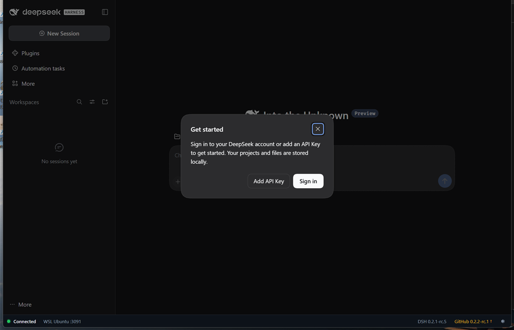
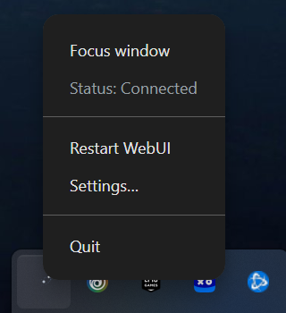
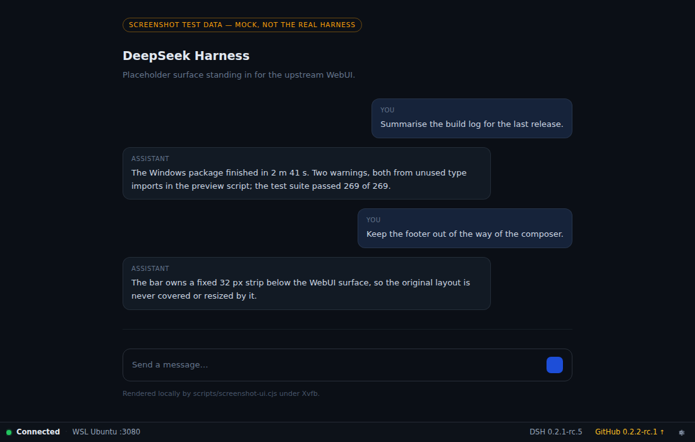
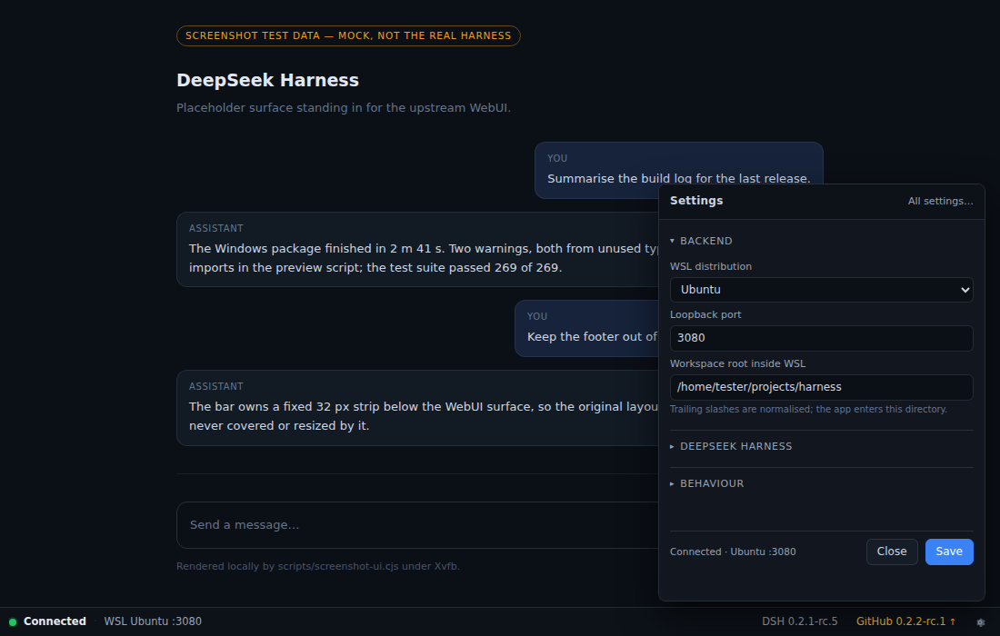
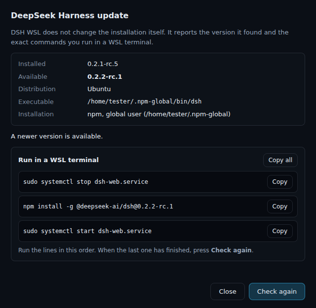

<h1 align="center">DSH WSL</h1>

<b>Оригинальный веб-интерфейс DeepSeek Harness в настоящем окне Windows — на вашем собственном WSL2.</b>

<a href="README.md">English</a> · <b>Русский</b>

  
  
  
  
  

  <a href="https://github.com/triagmas/dsh-wsl/releases"><b>⬇ Скачать для Windows (x64)</b></a>

DSH WSL — небольшая оболочка на Electron для веб-интерфейсов, работающих внутри WSL2.
Первый бэкенд — нативный **DeepSeek Harness** (`dsh web`): приложение запускает его в
вашем существующем дистрибутиве и показывает **неизменённый официальный WebUI** — тот же
интерфейс с теми же возможностями — в отдельном окне, без вкладок браузера и адресной
строки. Никакой копии интерфейса, никаких патчей апстрима, никакого второго чата.

DSH WSL запускает **ваш существующий `dsh`** — тот же исполняемый файл, который
запускает обычный `dsh web` в терминале WSL, — а **данные** держит в собственном профиле
(`~/.local/share/wsl-web-shell`, со своим `DSH_HOME`), поэтому сессии, проекты и
авторизации официального DeepSeek Harness для Windows не затрагиваются. Из-за отдельного
`DSH_HOME` сессии, созданные в приложении, не видны в `dsh web`, запущенном в терминале.
Изоляцию можно отключить в настройках, чтобы использовать и обычные данные `~/.dsh`.

> **Статус релиза.** Новейший опубликованный пререлиз —
> [`v0.1.0-beta.1`](https://github.com/triagmas/dsh-wsl/releases/tag/v0.1.0-beta.1).
> Он выпущен до переименования, поэтому содержит единственный portable EXE со старым
> именем `WSL-Web-Shell-…` — без Setup EXE. Пара **DSH WSL Portable + Setup** с
> `SHA256SUMS.txt` пока **не опубликована**; Windows CI собирает её как артефакт
> `dsh-wsl-windows-x64` при каждом успешном прогоне.

## Что вы получаете

**Свой WSL и свои данные.** Агенты, модели, инструменты и файлы проектов остаются в
вашем дистрибутиве Linux. DSH WSL никогда не меняет молча WSL, Node.js или глобально
установленный `dsh` и не трогает официальную установку DeepSeek Harness для Windows и
ваши проекты. Единственное, что он меняет, — **вашу установку DeepSeek Harness в WSL**, и
только когда вы нажимаете «Обновить» в приложении: тогда выполняется
`npm install -g @deepseek-ai/dsh@<версия>` в тот префикс, который эта установка уже
использует (с предварительной проверкой пути, происхождения, менеджера, прав и запущенных
процессов и с автоматическим восстановлением прежней версии при любой ошибке).

**Окно, которое ведёт себя как приложение.**

Закрытие окна оставляет приложение в трее: *Focus window*, живой *Status*,
*Restart WebUI*, *Settings*, *Quit*. Бэкенд под присмотром: если он упадёт, DSH WSL
перезапустит его с ограниченным числом попыток и покажет честное состояние
переподключения вместо пустой страницы.

**Тонкая панель состояния, а не второй интерфейс.** Собственная панель высотой 32 px
показывает состояние соединения, версию работающего DSH и последний релиз на GitHub.
Шестерёнка открывает компактное окно настроек (дистрибутив, порт, изоляция,
workspace) — сам WebUI никогда не изменяется.

| Панель состояния | Настройки |
|---|---|
|  |  |

**Обновление DeepSeek Harness в один клик.** Когда выходит новая опубликованная версия,
панель предлагает её. Точная версия устанавливается рядом с работающим runtime,
собственный бэкенд останавливается только на момент замены, предыдущая установка
сохраняется для отката, а новая версия считается успешной лишь после того, как реально
отдала WebUI. Прерванная замена чинится при следующем запуске.

## Portable или Setup

Оба пакета собираются из одного коммита и работают одинаково; отличается только способ
установки.

| | **Portable** | **Setup** |
|---|---|---|
| Файл | `DSH-WSL-<version>-x64-Portable.exe` | `DSH-WSL-<version>-x64-Setup.exe` |
| Установка | не нужна — запуск двойным щелчком | обычный мастер установки Windows |
| Права администратора | не нужны | не нужны (установка для пользователя) |
| Ярлыки | нет | запись в «Пуске», ярлык на рабочем столе по желанию |
| Удаление | удалить сам EXE | «Приложения» → *DSH WSL* → Удалить |

Оба варианта используют один профиль (`%APPDATA%\wsl-web-shell`) и один изолированный
runtime в WSL, поэтому настройки и версия DSH общие, какой бы вы ни запустили.
Подробности, поведение установщика и проверки в CI: [docs/packaging.md](docs/packaging.md).

## Быстрый старт

**Нужно:** Windows 10/11 x64 с WSL2, существующий дистрибутив (пресет по умолчанию
`Ubuntu`) и установленный **вами** DeepSeek Harness CLI `dsh` внутри него — глобально
или в изолированном runtime DSH WSL.

1. Откройте [страницу релизов](https://github.com/triagmas/dsh-wsl/releases) и
   скачайте `DSH-WSL-<version>-x64-Portable.exe` (без установки) или
   `DSH-WSL-<version>-x64-Setup.exe`, затем сверьте файл с `SHA256SUMS.txt`. Пока этот
   релиз не опубликован, оба файла лежат в артефакте `dsh-wsl-windows-x64` последнего
   успешного прогона Windows CI. Бинарники не подписаны, поэтому SmartScreen может
   предупредить о неизвестном издателе.
2. Запустите DSH WSL. Орбитальный экран показывает реальные этапы старта: проверка
   WSL, поиск runtime, запуск бэкенда, обмен токеном.
3. Официальный WebUI появляется сразу после готовности бэкенда. Дистрибутив, порт и
   режим изоляции меняются в настройках (шестерёнка).
4. Когда публикуется новый релиз DeepSeek Harness, нажмите плашку в панели состояния:
   DSH WSL обновит изолированный runtime и перезапустится.

## Документация

| | |
|---|---|
| [Упаковка: Portable и Setup](docs/packaging.md) | артефакты, установщик, CI, цели перезапуска |
| [Архитектура](docs/architecture.md) | модель процессов, супервизор, композиция окна |
| [Спецификация](docs/spec.md) | состояния, жизненный цикл трея, правила безопасности |
| [Панель состояния и настройки](docs/footer.md) | собственная обвязка окна |
| [Обновление runtime в один клик](docs/update.md) | транзакция, журнал, откат |
| [Контракт с апстримом](docs/upstream-dsh-web.md) | как запускается и проверяется `dsh web` |
| [Диагностика и поддержка](docs/diagnostics.md) | логи, профиль, состояния ошибок |
| [Разработка](docs/development.md) | команды, тесты, структура |
| [Доказательства](docs/evidence/r02.md) | реальные приёмочные прогоны с артефактом и SHA-256 |

## Проверки

CI прогоняет typecheck, lint, юнит-тесты (независимая от Electron логика и инварианты
исходников), рендер-смоуки собственных поверхностей, проверку реальных пикселей экрана и
Windows-задание упаковки, которое устанавливает, перезапускает и удаляет оба варианта.
Реальные приёмочные прогоны на живой Windows 11 + Ubuntu WSL2 записаны в
[docs/evidence/r02.md](docs/evidence/r02.md), [docs/evidence/r09.md](docs/evidence/r09.md)
и [docs/evidence/r091.md](docs/evidence/r091.md). Зелёные проверки исходников никогда не
выдаются за замену этим прогонам.

## Лицензия

MIT — см. [LICENSE](LICENSE). Веса моделей DeepSeek и официальные бинарники Windows не
распространяются.
