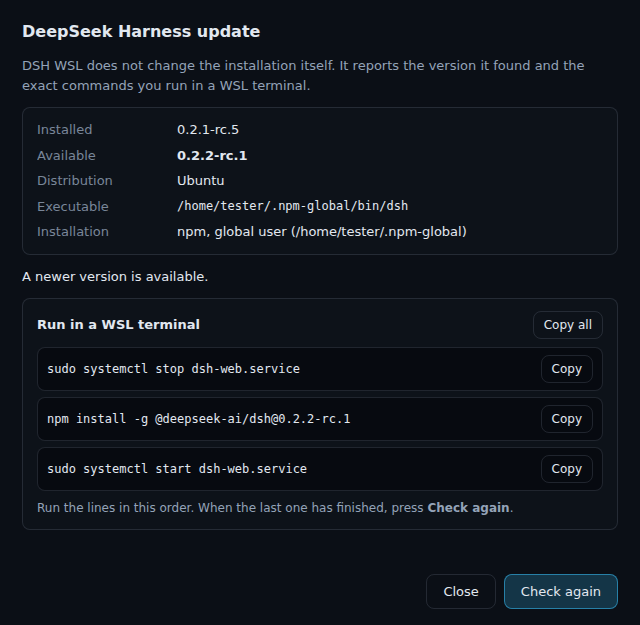
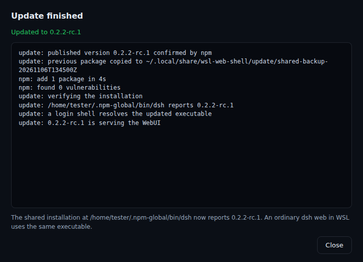

# One-click update (issues #12 and #17)

The footer bar can update the **DeepSeek Harness installation the app runs**. Since
issue #17 that is not an app-private copy any more: DSH WSL starts the `dsh` the
selected WSL distribution already has — the same executable an ordinary
`dsh web` in a terminal starts — and the in-app update changes exactly that
installation, after an explicit confirmation.

The official Windows DeepSeek Harness, the user's projects, any other WSL
distribution, the global `npm` configuration and unrelated packages are never
touched. The app never uses `sudo`/UAC, never installs into an alternate prefix
and never signals a process it does not own.

```
footer pill (only while an update exists)
   -> confirmation window   (distro, executable, install scope, versions, warning)
   -> terminal window       (streamed npm output; Close only when the run finished)
   -> verified recovery snapshot in the app data root (offline, before anything changes)
   -> owned backend stopped, npm install -g into the reported prefix
   -> version AND login-shell re-verified at the same real path, backend started
   -> app relaunches the packaged EXE (or says it cannot)
```

## What the user sees

Both screenshots are rendered by the real confirmation and terminal pages
(`src/update/`) through the repository harness `scripts/screenshot-ui.cjs`
(`npm run screenshots`), which drives them with fixture data and never runs a real
update. Paths, versions and the distribution name are test values. They are
documentation-sized captures (sized to their content), not a strict copy of the
production window geometry.

| Confirmation | Terminal |
|---|---|
|  |  |

## What "version" means here

Two independent things, deliberately kept apart:

| Concept | Where it lives | Changed by |
| --- | --- | --- |
| **Binary / installation** | the distribution's npm prefix (for example `~/.npm-global` or `/usr/local`) | your package manager, or this update |
| **Data** (`DSH_HOME`, agents home, caches, temp, workspace) | `<root>` (`~/.local/share/wsl-web-shell` by default) | nothing but DeepSeek Harness itself |

The "isolated environment" setting isolates **data**, not the executable. Turning
it off makes the app also use the normal `~/.dsh` data; it never changes which
`dsh` binary runs.

Two browser windows attached to the same running backend share that server's
data. A separately started `dsh web` in a terminal does **not** share the isolated
`DSH_HOME`, but — after an update — it runs the same updated binary.

## When the offer appears

`VersionSnapshot.updateAvailable` (produced by the informational GitHub lookup,
18 h cache) decides it. The pill with the circular arrow is `hidden` whenever
`updateAvailable` is false, so the bar never shows an action for a version that
does not exist.

## Guards (`src/main/core/update.ts`, `src/main/core/dsh-locate.ts`)

`planSharedUpdate()` is pure and rejects, before anything runs:

| Reason | Condition |
| --- | --- |
| `invalid-version` | target is not an exact release (`^0.2.2`, `latest`, `…; rm -rf /`) |
| `not-newer` | `compareSemver(target, installed) <= 0` |
| `installed-unknown` | the executable did not report a parsable version |
| `missing-installation` | no `dsh` was found in the distribution |
| `custom-executable` | a `dshPath` is pinned in Settings — the app only updates the installation npm manages, and says how to do it manually |
| `unsupported-manager` | the installation is not npm-managed (pnpm, distro package, standalone binary) |
| `foreign-runtime` | the resolved realpath is not inside `<prefix>/lib/node_modules/@deepseek-ai/dsh` |
| `not-writable` | the prefix needs elevated rights; the window shows the exact `npm install -g --prefix …` command instead |
| `foreign-process` | another `dsh` process runs from the same installation (the app never kills it) |
| `no-npm` | npm is not available in that distribution |
| `login-shell-mismatch` | a login shell resolves a different executable than the app runs, cannot resolve one at all, or cannot report its version — so updating would not provably change the CLI a terminal uses |

The provenance comes from a read-only inspection (`INSPECT_SHARED_SCRIPT`),
never from guessing:

1. the executable is the one a **login shell** resolves (`bash -lc 'command -v dsh'`),
   then the minimal `--exec` PATH, then the conventional locations — the retired
   private `<root>/runtime/bin/dsh` is never selected, only reported as `legacy=yes`;
2. `readlink -f` gives the real file, which must be inside the package directory;
3. `npm prefix -g` inside that same distribution gives the prefix, and the prefix
   must be writable by the current user;
4. `/proc` is scanned for processes whose command line contains that real path
   (the app-owned backend PID is excluded), so a foreign session blocks the update
   instead of being killed.

Everything above is re-checked inside the update script **before** the install,
so a changed environment between plan and execution aborts with nothing written.

## The scripts (`src/main/wsl/update-args.ts`)

Every step runs through `wsl.exe -d <distro> --exec /bin/sh -c <script> <args…>`
with validated positional operands (prefix, versions, executable, package
directory, transaction id, npm, node, app root, owned pid) — no interpolated
command strings.

| Step | Script | What it does |
| --- | --- | --- |
| npm lookup | `NPM_VIEW_SCRIPT` | read-only `npm view @deepseek-ai/dsh@<ver> version`; an unpublished version stops the run |
| inspect | `INSPECT_SHARED_SCRIPT` | read-only report: `path`, `real`, `link`, `source`, `version`, `loginreal`, `loginversion`, `npm`, `manager`, `prefix`, `package`, `writable`, `foreign`, `legacy` |
| snapshot | `PREPARE_BACKUP_SCRIPT` | copies the package and the executable shim state into `<app root>/update/shared-backup-<tx>`, verifies that the copy runs and reports the installed version, records the immutable identity (`meta`) and renames the directory into place |
| update | `UPDATE_SHARED_SCRIPT` | requires that verified snapshot (`exit 79`/`80`); re-checks prefix agreement (`76`), writability (`75`), the pinned real path and package identity (`81`), the current version (`71`), already-installed (`77`), login-shell agreement (`82`) and foreign processes (`78`); runs `npm install --global --prefix <prefix> @deepseek-ai/dsh@<ver>`; then proves the version **and** that the executable stayed at the approved real path (`83`) and that a login shell runs it too (`84`) |
| rollback | `ROLLBACK_SHARED_SCRIPT` | restores the verified snapshot **offline** (no registry, no npm), and only falls back to `npm install` of the previous exact version when the snapshot is unusable; validates the destination first (`81`) |

### The recovery snapshot (blocking review B1)

An update cannot start without a snapshot that the app itself can verify. It is
created **before** the backend is stopped and before npm runs, in the app's own
data root, in a transaction-specific directory:

```
<app root>/update/shared-backup-<tx>/
  payload/          copy of <prefix>/lib/node_modules/@deepseek-ai/dsh
  dsh.link | dsh    the executable shim: its symlink target, or a copy
  meta              version, real path, prefix, package, entry, files, transaction
```

The directory is built as `…-<tx>.tmp`, verified (payload present, entry point
present, the copy really reports the installed version, at least one file), and
only then renamed into place — a half-copied snapshot is never mistaken for a
usable one. Symlinked locations are refused, an existing snapshot is never
deleted, and nothing is written outside the app data root. The journal records
the path, and recovery restores from it, so **an interrupted install can be
repaired with no registry access at all**. `npm install` of the previous version
is only the fallback.

The snapshot also carries a deterministic content manifest (`cksum` over the
sorted relative file list, plus `meta`'s file count). `snapshot_ok()` recomputes
it before **every** consumer runs, so a truncated or modified backup is refused
instead of being copied over a working installation, and a `.tmp` directory that
already exists is rejected before any removal — cleanup only ever removes a tree
the current invocation created.

### The snapshot step runs Node the way the shim does (issue #27)

An npm installation of the CLI is usually a symlink to `lib/bin.js`, whose first
line is `#!/usr/bin/env node`. Every snapshot verification step executes that
file, so it needs a `node` on `PATH`. A `wsl.exe --exec /bin/sh` command starts
with a minimal `PATH` that does not contain the user's Node directory, therefore
the resolved runtime is prepended at the top of `PREPARE_BACKUP_SCRIPT` — exactly
as the inspect, npm-lookup, update and rollback scripts already do, and
independently of the isolation setting (`$7` is the resolved runtime, `-` when it
is unknown). Without it the version probe printed nothing and the snapshot was
refused with `81` and `reports [] instead of [<version>]` even though the
installation was healthy.

A refused snapshot reports its own exit status and the last line of script
output in the update window and in `app.log`, so the message names the real
cause (`exit code 81: backup: … reports [] instead of [0.2.1-rc.5]`) instead of
the generic "check free space" advice that only fits some failures. That line is
subprocess output, so it goes through the same sanitizer as a terminal line
before it can reach the UI state: ANSI escapes and control characters are
stripped, credentials (`?token=…`, `token: …`) are redacted, whitespace is
collapsed and the text is capped at 200 characters with an ellipsis. An empty
result keeps a bounded fallback, so the exit code is never lost.

### The snapshot fits in its budget (issue #31)

The first real in-app CLI update failed closed for the right reason but at the
wrong cost: the manifest was produced by one `cksum` fork per file, which measured
**134 s per pass** on the 838 MB / 61 833-file DSH package, and the stage needs two
passes, so the 120 s gateway budget expired mid-manifest and the update stopped
with "no verified recovery snapshot, nothing was changed".

The recorded format is unchanged — one `CRC SIZE PATH` line per file, `LC_ALL=C`
sorted, relative to `payload/` — and stays byte-identical: the batched manifest of
the real package compared `cmp`-equal against the old per-file loop. What changed
is how it is computed: the payload is walked once with `-print0`, sorted with
`sort -z` and checksummed in batches of 500 paths by `xargs -0`. Measured on the
same package: **134 s → 1.25 s** per pass (**1200 → 3** `cksum` forks for 1200
files), and a full snapshot from start to verified rename in **11.6 s** (copy
2.9 s, manifest 4.5 s including the shim record, verification 4.0 s).

Each stage writes to a file instead of being piped into the next, because `dash`
has no `pipefail` and a pipeline would report the status of its last command only.
A failing `find`, `sort` or `cksum` therefore aborts the snapshot instead of
recording a short manifest, the record count is checked against the number of
files, and a payload whose file names contain a newline is refused — such a name
would make the line-based format ambiguous.

### Phase markers and the timeout budget (issue #31)

```
<app root>/update/<tx>.progress      epoch-milliseconds + phase name, per line
```

`PREPARE_BACKUP_SCRIPT` appends `start`, `copy`, `manifest`, `rename`, `verify`
and `done` as it goes and removes the file when the snapshot verifies. Because the
gateway kills the whole `wsl.exe` command when the budget expires, the file is the
only record of where the time went: the cleanup step reprints it and the failure
message names the phase (`… (stopped during: manifest)`), while `app.log` carries
the full trail (`start@0ms -> copy@84ms -> manifest@2984ms -> …`).

The budget was raised to **300 s** only after measuring: `cp -a` takes 3.7–4.0 s
warm and 90 s with a cold page cache under load, each manifest pass 1.25 s, so the
worst observed end-to-end is ~95 s and a typical run 11.6 s. 300 s is three times
the worst measurement and no longer hides a hang, since a stuck run now names its
phase.

### Cleaning up after an interrupted attempt (issue #31)

When the budget expires, `wsl.exe` is killed and — measured — its whole Linux
process subtree dies with it within 0.5 s: no surviving child or grandchild still
writes into the tree. The script therefore cannot clean up after itself, so the
app finishes the job with `CLEAN_SNAPSHOT_SCRIPT`: it prints the recorded phase
lines, removes `<update>/shared-backup-<tx>.tmp` and this transaction's progress
and manifest work files, and nothing else.

The scope is provable rather than assumed: the transaction id must match the
transaction pattern, the update directory must canonicalise to itself, the target
must be a real directory whose direct entries are exactly `payload/` (a real
directory) and `manifest` (a regular file), and any symlink is a refusal (`79`).
A *verified* snapshot (`shared-backup-<tx>` without `.tmp`) is never touched, an
unrecognized tree is left in place for the owner to inspect, and a failed cleanup
never masks the original failure. Measured: removing an 844 MB / 61 833-file tree
takes 0.97 s, so the cleanup budget is 60 s.

### Identity at the last safe moment (B2)

`realPath` from the plan is passed into the mutating script and compared again
right before the install, together with a re-canonicalised package directory, the
expected npm package name in its `package.json`, containment in
`<prefix>/lib/node_modules`, and the npm prefix reported by `npm prefix -g`.

`dest_trusted()` additionally walks every ancestor between the prefix and the
package directory and requires each one — and the executable's own directory — to
be a real directory that canonicalises to itself, before any install, and again
inside the restore path before a single `rm -rf`. A parent swapped for a symlink
therefore aborts with `81` instead of writing through it; a foreign tree behind
such a link is never touched.
A moved symlink, a foreign package at that path, a symlinked package directory, a
changed prefix or a changed installation manager aborts with `exit 81` and the
message "nothing was changed". Rollback re-validates the destination the same way
before replacing anything, so no `rm -rf` can run through a redirected path.

### The login shell must run the update too (B3)

Before and after the install the script resolves `dsh` through
`bash -lc 'command -v dsh'`. **Unknown is not agreement:** a shell that resolves
nothing (no `bash`, no `dsh` on the shell `PATH`, an unreadable profile) or cannot
report the installed version stops the update before anything is written (`82`).
A different path or version after the install is a **failure**, not a warning: the
snapshot is restored and the run exits `84`; the runner refuses `done` unless a
fresh inspection shows the login shell resolving and reporting the updated
version. The runner repeats the same comparison from a
fresh inspection (real path and login-shell version) before it reports success, so
a green result always means "the app and an ordinary terminal run the same updated
file".

Failure handling inside the update script: an npm failure restores the snapshot
and exits `72`; a version that does not become the target is rolled back the same
way (`74`); if the restore itself fails the script exits `73` and the app keeps
the journal and blocks further starts.

## Transaction: quiesce, install, verify, recover

1. `checking` — the exact version exists on npm;
2. `inspecting` — fresh provenance, and the plan is re-validated with that data;
3. `stopping` — the update lock is set (auto-recovery, health checks, tray
   restart/retry and Quit are refused), then only the **app-owned** backend is
   stopped through the normal ownership-checked path;
4. `installing` — npm replaces the package in the reported prefix; npm output is
   streamed to the window;
5. `verifying` — the executable the launcher uses must report exactly the target
   version, independently of what npm printed;
6. `starting` — a full backend start (distribution, runtime resolution, token
   exchange, authenticated request). Success is only reported after this.

A journal (`<userData>/update-journal.json`, `version: 2`) records transaction id,
phase, distro, executable, realpath, prefix, package directory, app root, npm,
target and installed version. Writing it is **fail-loud** (flush, rename, read
back), and it is written before the install starts. If the app dies mid-update,
the next start inspects the executable and acts on evidence:

| Observed state | Action |
| --- | --- |
| reports the target version at the recorded real path | `finalize` — the update had finished; start normally |
| reports the target version at another path | `rollback` — the update did not install what the plan approved |
| reports the previous version | `abandon` — nothing was changed; forget the record |
| reports anything else, or is missing | `rollback` — reinstall the previous exact version, then start it |
| cannot be inspected at all | `blocked` — the app refuses to start and explains it |

A journal written by the retired private-runtime updater (`version: 1`) is not
misapplied: that copy is no longer started, so the record is cleared with a
visible note and the normal start continues.

Every failure path reinstalls the previous version, starts it and reports
`rolled-back`, never `done`. The journal is cleared **only** by a proven outcome:
a new version that serves the WebUI, an unchanged installation, or a restore
whose backend really started. A failed restore, or a restored installation whose
backend does not start, keeps the journal, blocks further starts and names the
exact `npm install -g @deepseek-ai/dsh@<version>` command to run by hand.

Start-up reading has three outcomes: **no journal** — a normal start; **a valid
journal** — repair it; **a journal that exists but is corrupt or unreadable** —
the record is kept, DeepSeek Harness is not started and the app opens in a
terminal blocked state. "Exists" is decided with `lstat`, so only
`ENOENT`/`ENOTDIR` mean there is no journal.

## Terminal window

The main process keeps a rolling buffer of 400 lines and publishes `dropped`
(how many lines fell off the front). The renderer rebuilds the buffer when that
number changes and appends otherwise, so the stream keeps moving past 400 lines.
Output is sanitized (ANSI/control characters stripped, secrets redacted, 320
characters per line) and written with `textContent`.

While a run is active the window is not closable and tray Quit is refused, so a
quit cannot interrupt the install. A finished or rolled-back run is closable.

## Confirmation window

`src/update/confirm.html` shows the distribution, the executable path, the install
manager and scope, the versions, and the explicit warning that this changes the
**shared** WSL installation a terminal uses. When the app refuses, the same window
explains why and shows the manual command.

## Relaunch

Two packages exist (portable EXE and NSIS Setup EXE) and they restart differently;
`resolveRelaunchTarget()` (pure) decides which target is safe:

- **Portable** — `PORTABLE_EXECUTABLE_FILE` must be an existing `.exe`. A portable
  build runs from a temporary extraction directory, so relaunching
  `process.execPath` would start a copy that is deleted right after exit.
- **Installed** — `process.execPath` is accepted only when the build is packaged
  (`app.isPackaged`) and the `resources` directory with its `app.asar` belongs to
  that same executable.
- **Anything else** — the app does not claim to restart itself: the terminal
  window explains that the update succeeded and the app has to be started again.

## Windows and IPC

| Surface | File | Notes |
| --- | --- | --- |
| confirmation | `src/update/confirm.html` | 560×460, modal, `sandbox: true`, CSP `default-src 'none'` |
| terminal | `src/update/progress.html` | 720×520, resizable, `aria-live` pre |
| bridge | `src/preload/update.ts` | `probe/start/state/onState/close` only |

Channels: `footer:open-update`, `update:probe`, `update:start`, `update:state`,
`update:close` and the `update:state` event. All are registered through the
existing `isTrustedSender` guard; the renderer performs no network I/O.

## Verification

- `tests/dsh-locate.test.ts` — provenance parsing, path containment, npm layout
  classification, scope wording.
- `tests/update.test.ts` — every guard, exact version equality, phase model,
  journal round-trip (v2) and the legacy v1 record, every recovery decision, and
  the full runner transaction (order, refusal after re-inspection, install
  failure, wrong version after install, failed start, failed rollback, journal
  before the install).
- `tests/journal.test.ts` — the real file-backed store (durability, atomic
  replace, corrupt/unreadable record) and start-up handling of every state.
- `tests/update-fixture.test.ts` — **executes the real scripts** against a
  throwaway npm prefix with stub packages: the app resolves the same file a login
  shell resolves, detects the npm installation, updates it in place, verifies the
  new version at the same path, restores the previous version, refuses while a
  foreign process runs, and refuses a non-writable prefix. Offline, no WSL, no
  owner installation — see [update-integration-test.md](update-integration-test.md).
- `tests/supervisor.test.ts` — quiesce stops only the owned backend and blocks
  recovery/restart/retry while locked; a failed resume is reported.
- Windows CI — packaged relaunch check for both Portable and Setup builds.

A real update of the owner's global WSL installation is a separate, explicitly
approved step and is not performed by CI or by these tests.
